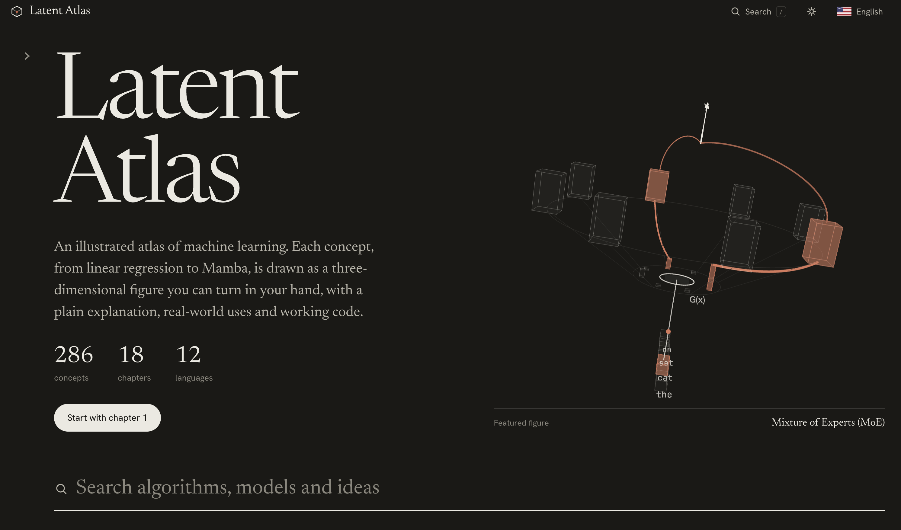

# Latent Atlas

**Live site: https://latent-atlas-pied.vercel.app/**



An illustrated atlas of machine learning: 286 concepts from linear regression to Mamba, each drawn as a rotatable 3D figure, with an explanation, typical use cases, an industry example and a Python code example. The interface and all text are available in 12 languages (ko, en, es, zh, ja, fr, de, pt, ru, ar, hi, it). The default language follows the browser; the flag in the top-right corner switches it.

## Run locally

The site is static. Serve the `dist/` folder with any static server:

```bash
cd dist
python3 -m http.server 8000
# open http://localhost:8000
```

Opening `dist/index.html` directly from the file system also works in most browsers. three.js and the fonts load from public CDNs, so an internet connection is needed.

## Deploy

The site is hosted on Vercel at https://latent-atlas-pied.vercel.app/, connected to this repository. Every push to `main` redeploys it. `vercel.json` tells Vercel to serve `dist/` with no build command, so run `python3 build.py` and commit `dist/` before pushing.

Any other static host works the same way with `dist` as the publish directory.

## Project layout

```
index.html            page shell and styles
src/core.js           3D drawing kit (lines, dots, boxes, surfaces, labels)
src/stage.js          WebGL renderer, orbit controls, auto-framing
src/viz-a.js … viz-e.js   one builder per figure type
src/registry.js       the 286 concepts: id, chapter, name, figure type, parameters
src/app.js            routing, language switching, search and autocomplete, concept pages
src/flags.js          flag icons and language list
content/en/part*.json English text, formulas and code
content/<lang>/       translations (items*.json) and interface strings (ui.json)
content/legend.json   translated figure legends
static/               favicons (copied to the root of dist/) and the README screenshot
build.py              assembles dist/ from src/, content/ and static/
dist/                 the built site
```

## Rebuild after editing

```bash
python3 build.py
```

## Adding a concept

1. Add a row to `src/registry.js`: `['id','chapter','English name','figureType',{params}]`.
2. Add its English entry to one of `content/en/part*.json` (`n`, `d`, `f`, `u`, `x`, `c`).
3. Add translations to `content/<lang>/items*.json`.
4. Run `python3 build.py`.
